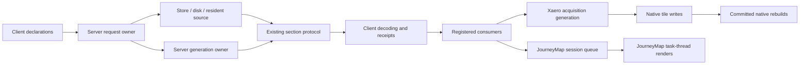

# Current ownership and data flow

LSS receives distant-column declarations, resolves resident/disk/store/generation sources, serializes the existing wire formats and delivers sections to registered consumers. The server owns generation decisions. Receive OFF retires acquisition; it is distinct from disconnecting or replacing a world. Wire compatibility and LSS/VSS cross-brand adoption remain invariant across support tiers.

The Xaero facade delegates lifecycle orchestration to `XaeroSession`. `XaeroBindings` caches external member descriptors; `XaeroAcquisitionQueue` contains acquisition/debt membership; `XaeroTileWriter` owns prepared-tile application; `XaeroRebuildScheduler` holds committed native updates and frame work. The extraction preserves the previous thread topology and lock order. See the implementation ownership matrix for field-level locks, retirement events and receipt owners. OFF must retain committed rebuilds for the same native world. Disconnect/world replacement retires native ownership; old callbacks cannot settle new-session work. `XaeroSession` also owns the open-region window (heap-sized, 12 to 64 regions; a region holds a slot from grant until its writes commit) and consults `MapMemoryGuard`, which halts map writes while post-collection old-generation heap stays above 85% and resumes below 70%.

JourneyMap ingestion is reflection-only and never initializes JourneyMap classes itself. The client network thread encodes each delivered column into JourneyMap's snapshot format and enqueues it on `JourneyMapSession` with a deferred-acceptance receipt. The client tick pumps the session: it checks JourneyMap's world identity, mapping switch and dimension, then submits one bounded batch at a time to JourneyMap's own task thread, which decodes, renders and releases each column in (z, x) order. Every receipt closes exactly once: accepted after a day-map render, otherwise reported for re-serve. The session's queue occupancy feeds `IngestBackpressureGovernor`, the report shared with Xaero, so the map paces the want-set. Disconnect, world replacement and dimension change abandon queued work through the same receipts.

On lines with Folia, a fresh declaration gets one pump tick for an owning-region probe. If that callback is late, disk fallback still proceeds. A valid disk-header or store freshness response, a successfully queued store body, and an eligible empty disk/store fallback preserve this opportunity too: persisted content does not establish that loaded content is unchanged. Empty fallback means either no-data up_to_date or a successfully queued authoritative clear; ghost, edit-stale, rejected-body and rejected-clear results cannot arm a correction. Each admitted disk attempt retains one bounded opportunity for a loaded probe, including positions beyond the initial 512-position probe window. New declarations, including empty backpressure batches, replace only unadmitted backlog; they do not cancel admitted reads or their corrections. The worker validates the captured result against its registration, dimension, edit epoch, range and exact disk-attempt identity. A corrective body waits until older pending reads and queued bodies for that column have drained, then consumes that exact retained attempt once. An all-air result explicitly clears terrain the client may already hold. Dirty events, retirement, range loss, expiry, rejected or excluded results, and replacement of the admitted attempt discard obsolete work. Retention is capped at 512 attempts and 2 MiB of serialized bodies per player for 10 seconds from the original admission; later declarations do not renew it, and an absent callback does not hold the request open. [Lifecycle](../../common/src/test/java/dev/vox/lss/common/processing/PairedIngressLifecycleTest.java) and [pump/router](../../paper/src/test/java/dev/vox/lss/paper/PaperPumpRouterAlignmentTest.java) tests cover these boundaries. Eight additional pump/router cases exercise store body/freshness and empty disk/store correction; four [freshness-rung exclusions](../../common/src/test/java/dev/vox/lss/common/processing/ReadFreshnessRungTest.java) reject ghost, stale and failed-enqueue paths.

Corrective frames use the existing wire format. `service.corrective_columns_sent` counts tagged frames only after the sender returns successfully. The soak request-conservation law subtracts that subset of responses because these frames do not consume a new declaration; ordinary send totals remain intact. [Accounting tests](../../common/src/test/java/dev/vox/lss/common/processing/CorrectiveSendAccountingTest.java) cover failed sends, pruning and retirement. On the client, a decoder checks its session epoch again after polling the shared queue. If an old worker has taken a replacement session's receipt, it reports failure through that receipt's captured owner, allowing a retry instead of silently accepting an undelivered column.

A connection's end is cleaned up on the thread that owns the state. Fabric fires its disconnect event from whichever comes first, netty's `channelInactive` or the server thread's own disconnect handling, so the Fabric handler only reads the player's id and hands the cleanup to the server thread ([contract test](../../fabric/src/test/java/dev/vox/lss/DisconnectCleanupThreadContractTest.java), and a gametest that fires the event from another thread). A stopped server runs that task on the calling thread; the cleanup then leaves the service to its own shutdown. NeoForge's logged-out event is on the server thread and Paper posts the quit to its lifecycle mailbox. Sponge's disconnect event is on the server thread for a player who was in the world, but it also fires for connections that never reached play, in one case from Sponge's login thread (open: [0.23.0 plan](../planning/2026-11-13-v0.23.0-plan.md) §11).

The client has the same rule. Fabric's client disconnect event arrives on netty on every kick and server stop, and usually when the player leaves, so the Fabric client does not listen to it: `ClientDisconnectHook` runs the cleanup at the head of `Minecraft.disconnect`, on the client thread, before the level is cleared, and where NeoForge posts its logged-out event ([contract test](../../fabric/src/test/java/dev/vox/lss/ClientDisconnectHookContractTest.java)). The cleanup logs an error if it ever runs on another thread.

Status is an immutable owner-produced read model. UI reads must not initialize request managers, probe optional APIs, read worlds or flush queues. Lifecycle invalidation is immediate even when collection is throttled. Export captures an allowlist before asynchronous filesystem work and never retains live world/manager handles. Server exports are local operator actions; they do not query foreign Folia regions.

`common` is Java 21 without Minecraft dependencies. `xplat` remains a source set compiled by Fabric and NeoForge, with same-FQN loader twins where required. Paper owns its loader-local world/scheduler contracts. `config/compatibility` and `config/lines` document and verify these differences; they do not erase genuine native encoding, mappings, ticket, game-rule or packaging adaptations.
